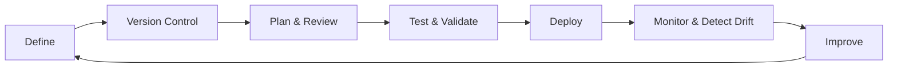

# ☁️ Infrastructure as Code (IaC) — Cloud Engineering Lab

<p align="center">
  <strong>Learn • Build • Test • Automate • Secure • Deploy</strong>
</p>

A hands-on repository for exploring modern **Infrastructure as Code**, cloud provisioning, configuration management, immutable infrastructure, container platforms, automation, and infrastructure security.

> **Project goal:** turn IaC concepts into repeatable, testable, secure infrastructure through practical labs, documented experiments, and reusable automation.

---

## 📚 Table of Contents

- [Overview](#-overview)
- [Core Principles](#-core-principles)
- [Infrastructure Lifecycle](#-infrastructure-lifecycle)
- [Technology Landscape](#-technology-landscape)
- [Labs & Projects](#-labs--projects)
- [Testing, Security & Governance](#-testing-security--governance)
- [Repository Structure](#-repository-structure)
- [Learning Roadmap](#-learning-roadmap)
- [References & Learning Resources](#-references--learning-resources)

---

## 🎯 Overview

Infrastructure as Code (IaC) applies software engineering practices to infrastructure. Instead of relying on manual, one-off configuration, infrastructure is described in code, versioned, reviewed, tested, and deployed through repeatable processes.

This lab explores IaC across cloud and hybrid environments, with a focus on:

- Repeatable infrastructure provisioning
- Configuration automation and consistency
- Version control and reviewable changes
- Automated testing and validation
- Infrastructure drift detection
- Security controls and policy enforcement
- Containers and cloud-native platforms

---

## 🧭 Core Principles

| Principle | What it means |
|---|---|
| **Infrastructure defined in code** | Represent infrastructure using files and reusable definitions. |
| **Version controlled** | Track changes, collaborate, review, and roll back where appropriate. |
| **Repeatable automation** | Reduce manual steps and make deployments consistent. |
| **Test before release** | Validate infrastructure changes before applying them. |
| **Immutable infrastructure** | Prefer replacing changed infrastructure with a known, tested version rather than modifying it unpredictably. |
| **Drift awareness** | Detect differences between the declared configuration and deployed resources. |
| **Security by design** | Integrate security checks, policies, and compliance into the workflow. |

---

## 🔄 Infrastructure Lifecycle



**Typical workflow:**
1. Define desired infrastructure and configuration.
2. Commit changes to Git.
3. Review the plan and impact.
4. Run validation, tests, and security checks.
5. Deploy approved changes.
6. Monitor infrastructure and detect drift.
7. Iterate and improve.

---

## 🧰 Technology Landscape

### ☁️ Infrastructure Provisioning

| Tool | Focus | Resource |
|---|---|---|
| AWS CloudFormation | AWS infrastructure provisioning | [AWS CloudFormation](https://aws.amazon.com/cloudformation/) |
| Azure ARM | Azure resource provisioning | [Azure Resource Manager](https://azure.microsoft.com/en-us/get-started/azure-portal/resource-manager/) |
| Terraform | Multi-cloud infrastructure provisioning | [Terraform](https://www.terraform.io/) · [Registry](https://registry.terraform.io/) |
| Digital Rebar | Hardware-friendly infrastructure provisioning | [RackN / Digital Rebar](https://rackn.com/products/rebar/) |
| Nix | Declarative, reproducible builds and artifacts | [Nix](https://nixos.org/) · [What is Nix?](https://serokell.io/blog/what-is-nix) |
| System Initiative | Modern infrastructure management approach | [System Initiative](https://www.systeminit.com/) |
| Serverless Framework | Serverless application deployment | [Serverless Framework](https://www.serverless.com/) |

### ⚙️ Configuration Management & Automation

| Tool | Focus | Resource |
|---|---|---|
| Ansible | Automation and configuration management | [Website](https://www.ansible.com/) · [Documentation](https://docs.ansible.com/) |
| Puppet | Configuration management | [Puppet](https://www.puppet.com/) |
| Chef | Configuration management | [Chef](https://www.chef.io/) |
| Salt | Automation and configuration management | [Salt](https://saltproject.io/) |
| Rundeck | Runbook and automation workflows | [Rundeck](https://www.rundeck.com/) |
| Packer | Machine image building | [Packer](https://www.packer.io/) |
| Make | Build and task execution | [GNU Make](https://www.gnu.org/software/make/) |

### 🐳 Containers & Orchestration

| Tool | Focus | Resource |
|---|---|---|
| Docker | Containerization | [Docker](https://www.docker.com/) |
| Docker Hub | Container image repository | [Docker Hub](https://hub.docker.com/) |
| Kubernetes | Container orchestration | [Kubernetes](https://kubernetes.io/) |
| Helm | Kubernetes package and deployment management | [Helm](https://helm.sh/) |
| Kubespray | Kubernetes cluster deployment using automation | [Kubespray](https://kubespray.io/#/) |
| CRI-O | Container runtime for Kubernetes | [CRI-O](https://cri-o.io/) |
| Artifact Hub | Kubernetes packages and artifacts | [Artifact Hub](https://artifacthub.io/) |
| CNCF | Cloud-native ecosystem and projects | [CNCF](https://www.cncf.io/) |

### 🧑‍💻 Development & Cloud Automation

| Tool | Focus | Resource |
|---|---|---|
| Git | Source control | [Git](https://git-scm.com/) |
| GitHub | Code hosting and collaboration | [GitHub](https://github.com/) |
| Boto3 | AWS automation with Python | [Boto3 / AWS SDK for Python](https://aws.amazon.com/sdk-for-python/) |
| AWS Lambda | Serverless compute | [AWS Lambda](https://docs.aws.amazon.com/lambda/) |
| WebAssembly | Portable application deployment target | [WebAssembly](https://webassembly.org/) · [WASM & Docker](https://wasmlabs.dev/articles/docker-without-containers/) |

---

## 🧪 Labs & Projects

> The project list below is a suggested hands-on path. Mark each lab complete as its implementation and notes are added to the repository.


- [✅] **Lab 01 — Git Fundamentals**: initialize a repo, branches, commits, pull requests, and change history.
- [ ] **Lab 02 — Terraform Fundamentals**: provision a small cloud environment; explore variables, outputs, state, and modules.
- [ ] **Lab 03 — Terraform Testing**: add native Terraform tests and experiment with test mocks.
- [ ] **Lab 04 — Infrastructure Drift**: intentionally change a resource and detect configuration drift.
- [ ] **Lab 05 — Configuration Automation**: use Ansible to configure a host and make runs repeatable.
- [ ] **Lab 06 — Image Building**: create a reproducible machine image with Packer.
- [ ] **Lab 07 — Container Basics**: package and run a small service using Docker.
- [ ] **Lab 08 — Kubernetes Deployment**: deploy an application and manage it with manifests and Helm.
- [ ] **Lab 09 — CI/CD Validation**: add automated validation, tests, and security scans to a Git workflow.
- [ ] **Lab 10 — Policy as Code**: define and enforce infrastructure guardrails using policy tooling.
- [ ] **Lab 11 — Python Cloud Automation**: automate a cloud task using Boto3.
- [ ] **Lab 12 — Serverless Experiment**: deploy a small event-driven function with AWS Lambda or Serverless Framework.

---

## 🔐 Testing, Security & Governance

### Infrastructure testing

- [ ] Terraform native tests — [Documentation](https://developer.hashicorp.com/terraform/language/tests)
- [ ] Terraform mocks — [Documentation](https://developer.hashicorp.com/terraform/language/tests/mocking)
- [ ] Terratest — [Framework](https://terratest.gruntwork.io/)
- [ ] Kitchen-Terraform — [GitHub](https://github.com/newcontext-oss/kitchen-terraform)
- [ ] Serverspec — [Framework](https://serverspec.org/)
- [ ] InSpec — [Compliance testing](https://community.chef.io/tools/chef-inspec)

### Security scanning & policy as code

| Tool | Purpose | Resource |
|---|---|---|
| Checkov | IaC security scanning | [Checkov](https://www.checkov.io/) |
| tfsec | Terraform security analysis | [tfsec](https://github.com/aquasecurity/tfsec) |
| DryRun Security | Developer-focused security testing | [DryRun](https://dryrun.security/) |
| OPA | Policy engine | [Open Policy Agent](https://www.openpolicyagent.org/) |
| AWS Config | AWS resource configuration and compliance | [AWS Config](https://aws.amazon.com/config/) |
| Azure Policy | Azure governance and policy enforcement | [Azure Policy](https://learn.microsoft.com/en-us/azure/governance/policy/overview) |
| Kyverno | Kubernetes policy management | [Kyverno](https://kyverno.io/) |
| OPA Gatekeeper | Kubernetes policy enforcement | [Gatekeeper](https://github.com/open-policy-agent/gatekeeper) |
| Cloud Custodian | Cloud resource policy and management | [Cloud Custodian](https://cloudcustodian.io/) |


### Security checklist

- [ ] Avoid committing credentials, secrets, or sensitive state.
- [ ] Use least-privilege access for automation identities.
- [ ] Validate infrastructure changes before deployment.
- [ ] Scan IaC for security misconfigurations.
- [ ] Apply policy checks where practical.
- [ ] Review network exposure and access rules.
- [ ] Document risks, assumptions, and cleanup steps for each lab.

---

## 📁 Repository Structure

```text
infrastructure-as-code-lab/
├── README.md
├── docs/
│   ├── concepts/
│   ├── architecture/
│   └── notes/
├── labs/
│   ├── 01-git-fundamentals/
│   ├── 02-terraform-basics/
│   ├── 03-terraform-testing/
│   ├── 04-drift-detection/
│   ├── 05-ansible-automation/
│   ├── 06-packer-images/
│   ├── 07-docker/
│   ├── 08-kubernetes-helm/
│   ├── 09-ci-cd-security/
│   ├── 10-policy-as-code/
│   ├── 11-python-boto3/
│   └── 12-serverless/
├── scripts/
├── diagrams/
└── resources/
```

Each lab should ideally include:

- `README.md` — objective, prerequisites, steps, and results
- Source files — infrastructure/configuration code
- `tests/` — automated validation when appropriate
- `cleanup.md` or cleanup instructions — avoid leaving billable resources running

---

## 🗺️ Learning Roadmap

### Phase 1 — Foundations
- [ ] DevOps principles and culture
- [ ] Git workflow and collaboration
- [ ] Infrastructure as Code concepts
- [ ] Cloud fundamentals

### Phase 2 — Provisioning & Automation
- [ ] Terraform basics and reusable modules
- [ ] CloudFormation or Azure ARM overview
- [ ] Ansible automation
- [ ] Python and Boto3 cloud automation

### Phase 3 — Build & Deploy
- [ ] Packer and image creation
- [ ] Docker containers
- [ ] Kubernetes fundamentals
- [ ] Helm deployments
- [ ] Serverless concepts

### Phase 4 — Quality & Security
- [ ] Infrastructure testing
- [ ] Drift detection
- [ ] IaC security scanning
- [ ] Policy as Code
- [ ] CI/CD validation workflow

### Phase 5 — Advanced Exploration
- [ ] Immutable infrastructure and immutable delivery
- [ ] WebAssembly exploration
- [ ] Nix and reproducible builds
- [ ] Cloud-native ecosystem research
- [ ] DORA metrics and continuous improvement

---

## 📖 References & Learning Resources

### Books & Courses
- **Infrastructure as Code: Dynamic Systems for the Cloud Age** — Kief Morris
- [DevOps Foundations](https://www.linkedin.com/learning/devops-foundations-23454205/)
- [Git Essential Training](https://www.linkedin.com/learning/git-essential-training-25677984)

### IaC, DevOps & Engineering Practices
- [What is DevOps? — The Agile Admin](https://theagileadmin.com/what-is-devops/)
- [Infrastructure as Code — Martin Fowler](https://martinfowler.com/bliki/InfrastructureAsCode.html)
- [Practical Test Pyramid — Martin Fowler](https://martinfowler.com/articles/practical-test-pyramid.html)
- [Strangler Pattern — Martin Fowler](https://martinfowler.com/bliki/StranglerApplication.html)
- [Immutable Servers — Martin Fowler](https://martinfowler.com/bliki/ImmutableServer.html)
- [Production Begins in Development](http://www.slideshare.net/dev2ops/velocity-2011-production-begins-in-development)
- [Immutable Delivery — The Agile Admin](https://theagileadmin.com/2015/11/24/immutable-delivery/)
- [DORA](https://dora.dev/)
- [NIST Cloud Definition (SP 800-145)](http://nvlpubs.nist.gov/nistpubs/Legacy/SP/nistspecialpublication800-145.pdf)
- [Git Tutorial](https://try.github.io/levels/1/challenges/1)

### Additional references
- [Terraform Registry](https://registry.terraform.io/)
- [Terraform — Managing Resource Drift](https://developer.hashicorp.com/terraform/tutorials/state/resource-drift)
- [Kubectl Cheat Sheet](https://www.bluematador.com/learn/kubectl-cheatsheet)
- [What is WASM?](https://wasmlabs.dev/articles/docker-without-containers/)
- [Kubernetes + WASM Case Study](https://www.cncf.io/blog/2022/11/17/better-together-a-kubernetes-and-wasm-case-study/)
- [Terraform MCP Server](https://github.com/hashicorp/terraform-mcp-server)

---

## 📈 Progress & Notes

Use this repository as a living engineering notebook. Record what you built, what broke, what you learned, trade-offs, cost considerations, and what you would improve in a production environment.


| Lab | Status | Notes / Lessons Learned |
|---|---|---|
| Git Fundamentals | 🟡 Planned | |
| Terraform Basics | 🟡 Planned | |
| Terraform Testing | 🟡 Planned | |
| Drift Detection | 🟡 Planned | |
| Ansible Automation | 🟡 Planned | |
| Docker | 🟡 Planned | |
| Kubernetes & Helm | 🟡 Planned | |
| IaC Security | 🟡 Planned | |

---

<p align="center">
  <strong>Infrastructure should be repeatable, testable, observable, and secure.</strong><br />
  <em>Build it as code. Validate it. Learn from it. Improve it.</em>
</p>
